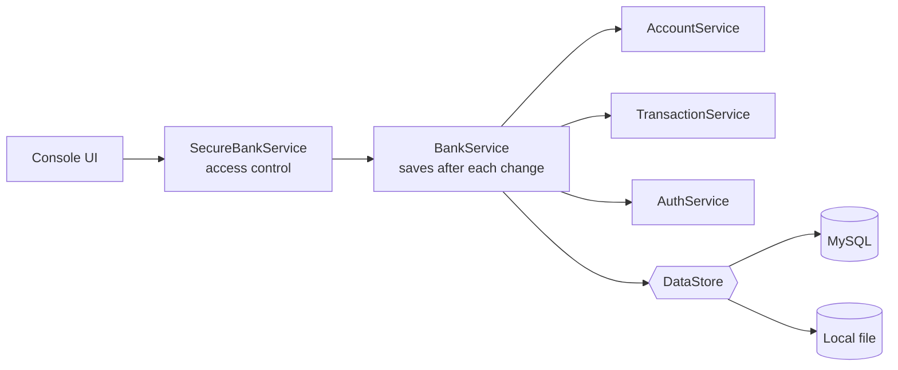
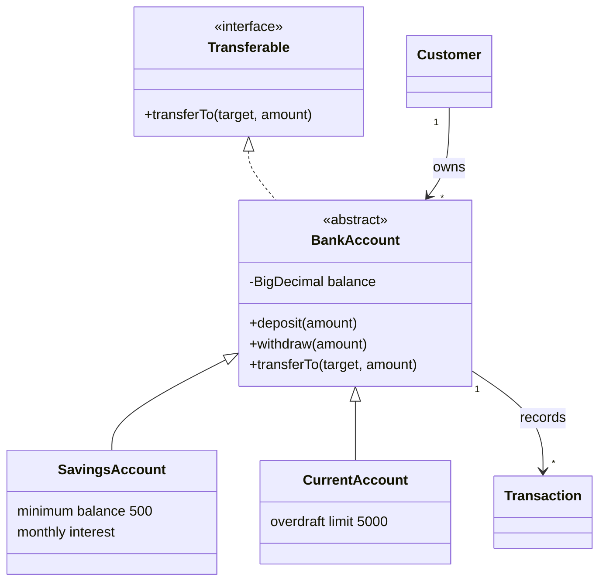
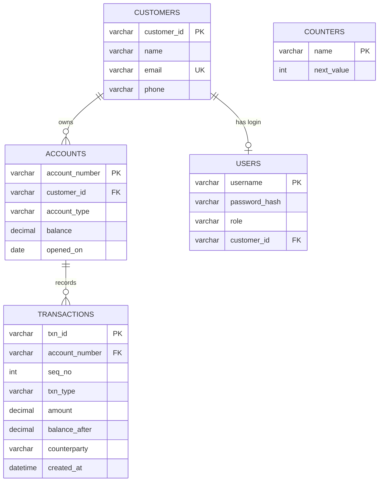

<div align="center">

# 🏦 Java Banking Management System

**A console banking application with MySQL storage, role-based login and automated tests, built with core Java.**


[Features](#features) • [Architecture](#architecture) • [Database](#database) • [Getting Started](#getting-started) • [Usage](#usage) • [Security](#security) • [Testing](#testing)

</div>

---

## Overview

This project simulates the core of a retail bank in the terminal. Customers hold **savings** and
**current** accounts, money moves through validated **deposits, withdrawals and transfers**, and every
change is recorded as a transaction and stored in **MySQL**.

The goal is to show how real banking rules (minimum balances, overdraft limits, atomic transfers,
access control) can be implemented in clean, layered, well-tested Java rather than in a flashy interface.

| | |
|---|---|
| **Language** | Java 17 |
| **Storage** | MySQL 8 via JDBC (plus an optional local-file mode) |
| **Interface** | Console menus for two roles: Admin and Customer |
| **Tests** | 68 JUnit 5 tests |

---

## Features

### Banking
- **Savings accounts:** ₹500 minimum balance, 4% p.a. interest credited monthly
- **Current accounts:** overdraft up to ₹5,000
- **Deposit, withdraw and transfer** with full validation
- **Atomic transfers:** a failed transfer changes neither account
- **Transaction history** per account: type, amount, date and time, other account, balance after
- **Search** by account number, customer ID or customer name

### Security and access
- **Login system** with a guided first-run admin setup
- **Passwords hashed** with PBKDF2-HMAC-SHA256 and a unique salt
- **Role-based access**
  - `ADMIN`: manages customers, accounts and logins
  - `CUSTOMER`: can only see and use their own accounts

### Engineering
- Exact money arithmetic with `BigDecimal`
- Custom exceptions for every kind of invalid operation
- Every change saved in **one database transaction**, with in-memory rollback if a save fails
- Stored balances re-verified against transaction history on load

---

## Tech Stack

| Technology | Purpose |
|---|---|
| **Java 17** | Application and business rules |
| **OOP & Collections** | Domain model, in-memory lookups |
| **JDBC + MySQL** | Persistent storage |
| **JUnit 5** | Automated unit and integration tests |
| **Maven** | Build, dependencies and a runnable jar |
| **Git & GitHub** | Version control |

---

## Architecture

The code is split into layers, and each layer has one job.



| Layer | Responsibility |
|---|---|
| `ui` | Menus and input, with no business rules |
| `service` | Business operations, authentication, authorization |
| `model` | Customers, accounts, transactions, users |
| `persistence` | MySQL and file storage behind a `DataStore` interface |

### Domain model



### OOP concepts applied

| Concept | Where it appears |
|---|---|
| **Encapsulation** | Balances are private and change only through validated methods |
| **Inheritance** | `SavingsAccount` and `CurrentAccount` extend `BankAccount` |
| **Abstraction** | `BankAccount` is abstract and defines what every account must provide |
| **Polymorphism** | The same `withdraw` call follows different rules per account type |
| **Interfaces** | `Transferable` and `DataStore` define contracts |
| **Composition** | `BankService` is built from account, transaction and auth services |

### Key design decisions
- **`BigDecimal` for money**, because floating-point types cannot represent values like 0.10 exactly
- **Validate before changing**: a transfer checks the source account first, so a rejected transfer leaves both balances untouched
- **One database transaction per save**, so a change is stored completely or not at all
- **Authorization in the service layer**, so the rules hold for any front end, not only the console menus
- **Same message for "unknown" and "not yours"**, so customers cannot probe for other people's accounts
- **Transaction history is the source of truth**: balances are recomputed and checked against it when data is loaded

---

## Database



The tables are created automatically on first run from [`schema.sql`](src/main/resources/schema.sql).

---

## Business Rules

| Rule | Value |
|---|---|
| Savings minimum balance and opening deposit | ₹500 |
| Savings interest | 4% per year, credited monthly |
| Current account overdraft limit | ₹5,000 |
| Amounts | Positive, at most 2 decimal places, up to ₹1,00,00,000 per transaction |
| Phone number | 10 digits, starting with 6 to 9 |
| Email | Valid format and unique per customer |
| Password | 8+ characters with at least one letter and one digit |
| Logins | One login per customer |

---

## Getting Started

### Prerequisites
- JDK 17 or newer
- Maven
- MySQL 8 or newer

### 1. Create the database
```sql
CREATE DATABASE bankdb CHARACTER SET utf8mb4;
CREATE USER 'bank'@'localhost' IDENTIFIED BY 'your_password';
GRANT ALL PRIVILEGES ON bankdb.* TO 'bank'@'localhost';
```

### 2. Add your connection settings
Create `db.properties` in the project folder (it is git-ignored):
```properties
url=jdbc:mysql://localhost:3306/bankdb?allowPublicKeyRetrieval=true&useSSL=false
user=bank
password=your_password
```

### 3. Build and run
```bash
mvn clean package
java -jar target/banking-system.jar
```

To try it without MySQL, use local file storage:
```bash
java -jar target/banking-system.jar --file
```

---

## Usage

On the first launch you create the administrator. After that, log in, add customers and accounts,
and give each customer a login so they can sign in and see only their own accounts.

### Admin menu
```
1. Create customer        8. Search accounts
2. Open account           9. List all accounts
3. Deposit               10. Apply monthly interest (savings)
4. Withdraw              11. Create customer login
5. Transfer              12. Create admin login
6. View account details  13. Change my password
7. Transaction history    0. Logout
```

### Customer menu
```
1. My accounts            5. Transfer
2. Account details        6. Transaction history
3. Deposit                7. Change my password
4. Withdraw               0. Logout
```

### Sample session
```
==============================================
   Java Banking Management System
==============================================

1. Login
0. Exit
Choose an option: 1
Username: admin
Password:

Welcome, admin (ADMIN).

Choose an option: 1
Full name: Asha Rao
Email: asha@example.com
Phone (10 digits): 9876543210

Customer created. Customer ID: CUST1001

Choose an option: 2
Customer ID: CUST1001
Account type (1 = Savings, 2 = Current): 1
Opening deposit (₹, 0 for none): 10000

Account opened. Account number: ACC100001
Balance: ₹10,000.00

Choose an option: 4
Account number: ACC100001
Amount to withdraw (₹): 2000

Withdrawal successful. New balance: ₹8,000.00

Choose an option: 4
Account number: ACC100001
Amount to withdraw (₹): 20000

[Error] Insufficient funds: available to withdraw ₹7,500.00, requested ₹20,000.00.
```

---

## Security

- Passwords are **never stored in plain text**: PBKDF2-HMAC-SHA256 with a random salt per password
- Hash comparison is **constant-time**
- A wrong username and a wrong password return **the same message**
- Login allows **3 attempts**, then the application exits
- Access rules are enforced in `SecureBankService`, not just hidden in the menus
- A customer cannot view, change or transfer from another customer's account
- Database credentials live in `db.properties`, which is excluded from version control

---

## Testing

```bash
mvn test
```

**68 JUnit 5 tests** cover:

| Area | What is checked |
|---|---|
| Account rules | Deposits, withdrawals, overdraft, minimum balance, transfers, interest |
| Validation | Amounts, names, emails, phone numbers, usernames, passwords |
| Authentication | Hashing, wrong credentials, weak passwords, password changes |
| Access control | Customers cannot touch other accounts or admin functions |
| Storage | File store, MySQL store, restart persistence, rollback after a failed save |
| Console UI | Scripted admin and customer sessions through the real menus |

The 6 MySQL integration tests run when `BANK_TEST_DB_URL` points to a throw-away database.

---

## Project Structure

```
src/
├── main/
│   ├── java/com/bank/
│   │   ├── Main.java
│   │   ├── ui/            console menus
│   │   ├── service/       BankService, SecureBankService, AccountService,
│   │   │                  TransactionService, AuthService
│   │   ├── model/         Customer, BankAccount, SavingsAccount, CurrentAccount,
│   │   │                  Transaction, User, Role, Transferable
│   │   ├── persistence/   DataStore, MySqlDataStore, FileDataStore, BankData, DbConfig
│   │   ├── exception/     custom exceptions
│   │   └── util/          Validator, PasswordHasher
│   └── resources/
│       └── schema.sql
└── test/java/com/bank/    JUnit 5 tests
```

---

## Future Enhancements
- Close accounts and edit customer details
- Admin password reset
- REST API with Spring Boot
- Web or mobile front end
- Account statements exported as PDF

---

## Author

**Hardhik**
